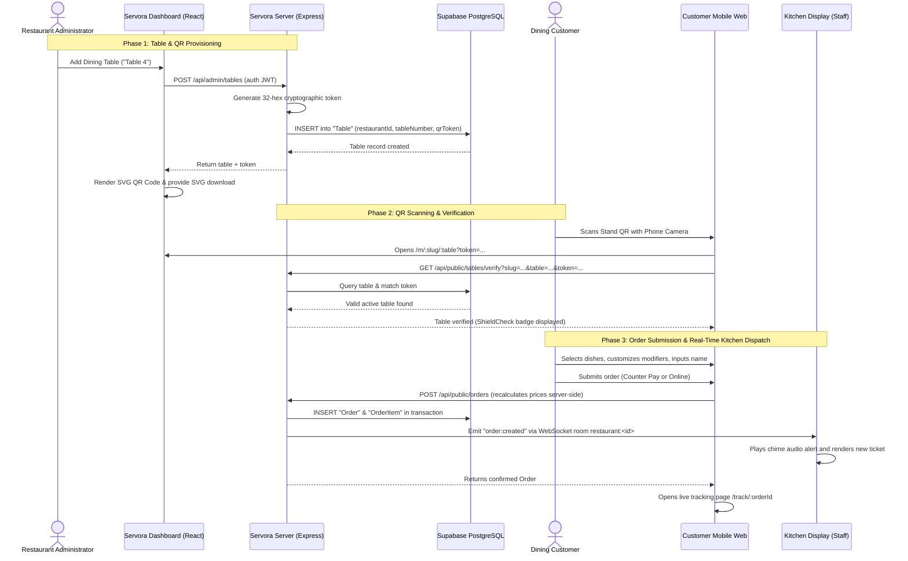

# Servora — Table QR Code Generation & Customer Ordering Workflow

This document specifies the end-to-end QR code lifecycle in Servora, from table provisioning to customer order fulfillment.

---

## 1. Architectural Overview

Servora uses **cryptographically secure, token-protected dynamic QR codes**. Rather than encoding a static, insecure table ID that any user could manipulate, every table stand encodes a 32-hex character random token that is authoritatively validated server-side.



---

## 2. Table Token Generation & Rotation

### 2.1 Cryptographic Token Structure
Tokens are generated on the backend inside [`server/src/services/qr.service.ts`](file:///c:/Users/athar/OneDrive/Desktop/PROJECTS/Sudarshan/server/src/services/qr.service.ts):
```typescript
public generateQrToken(): string {
  return crypto.randomBytes(16).toString('hex');
}
```
- **Length:** 32 hexadecimal characters.
- **Entropy:** 128 bits of cryptographic randomness.
- **Collision Resistance:** Enforced by `@unique` index on the `qrToken` column in PostgreSQL.

### 2.2 Token Regeneration (Rotation)
If a physical QR stand is photographed, compromised, or replaced, the administrator can rotate the token with one click in the Admin Tables view.
- **Endpoint:** `POST /api/admin/tables/:id/regenerate-qr`
- **Effect:** Immediately invalidates the previous QR token in the database and generates a new 32-character token. Any stale bookmarks or cached URLs immediately fail verification.

---

## 3. URL Construction & GitHub Pages Base Path Handling

The canonical QR URL is constructed dynamically based on the application's runtime environment:

```typescript
const getTableUrl = (tableItem: TableItem) => {
  const tableSlug = tableItem.tableNumber.toLowerCase().replace(/\s+/g, '-');
  const base = (import.meta.env.BASE_URL || '/').replace(/\/$/, '');
  const tokenQuery = tableItem.qrToken ? `?token=${encodeURIComponent(tableItem.qrToken)}` : '';
  return `${window.location.origin}${base}/m/${currentRestaurant.slug}/${tableSlug}${tokenQuery}`;
};
```

### URL Structure Breakdown
| Component | Production GitHub Pages Value |
| :--- | :--- |
| **Origin** | `https://atharva1811.github.io` |
| **Base Path** | `/Resturant-Qr-Order-System` |
| **Customer Route Prefix** | `/m/` |
| **Restaurant Slug** | `rustic-hearth` |
| **Table Slug** | `table-1` |
| **Query Parameter** | `?token=b0a1d4927f912c48e581290fa8b21c90` |
| **Complete Canonical URL** | `https://atharva1811.github.io/Resturant-Qr-Order-System/m/rustic-hearth/table-1?token=b0a1d4927f912c48e581290fa8b21c90` |

---

## 4. Distinct Payloads for Different Tables

Because each dining table receives its own unique table slug and independently generated cryptographic token, different tables produce completely distinct QR codes:

- **Table 1:**
  `https://atharva1811.github.io/Resturant-Qr-Order-System/m/rustic-hearth/table-1?token=32_hex_token_table_1`
- **Table 2:**
  `https://atharva1811.github.io/Resturant-Qr-Order-System/m/rustic-hearth/table-2?token=32_hex_token_table_2`

When scanned, the backend verifies that the token strictly matches the table record in the database. Tampered tokens or mismatched table numbers are rejected with HTTP 400.

---

## 5. Security & Isolation Guarantees

1. **Route Separation:** Customer ordering routes live under `/m/*` in `BlankLayout` without any navigation bars, admin sidebars, or internal controls.
2. **Server-Side Authorization:** Table creation and QR regeneration require an authenticated JWT bearing the `RESTAURANT_ADMIN` role.
3. **Tenant Scoping:** The `restaurantId` is extracted authoritatively from the JWT claims. An admin from Restaurant A cannot read, regenerate, or delete tables belonging to Restaurant B.
4. **Server-Side Price Recalculation:** Client-submitted cart prices are ignored upon checkout. The backend fetches unit prices from the database to prevent client-side cart tampering.
